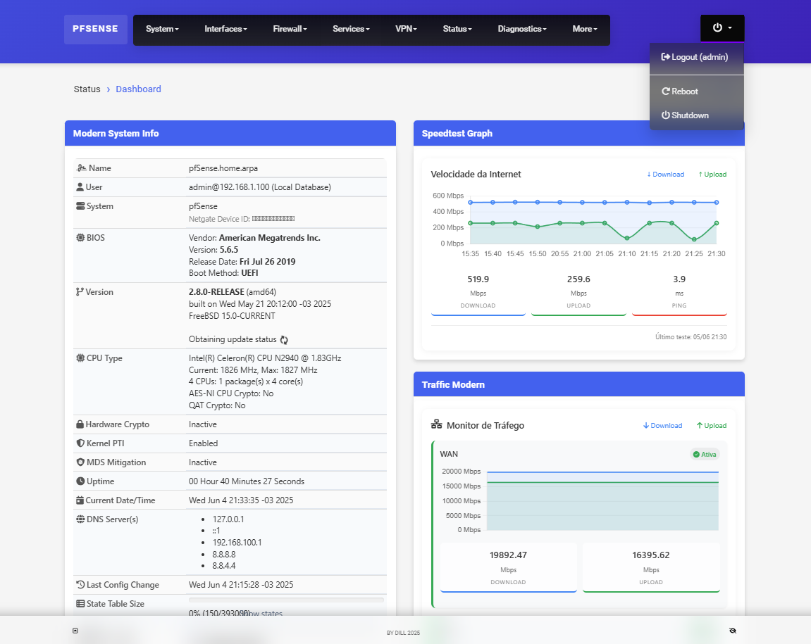
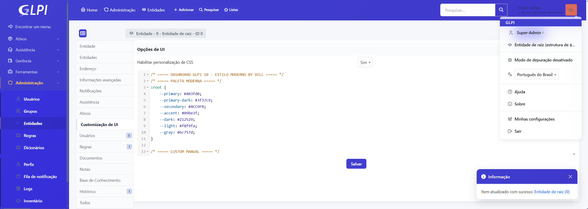

# Rune Infra Themes

Temas visuais modernos para as interfaces web do **pfSense®** e do **GLPI**, as ferramentas que a gente abre o dia inteiro em TI.

## Sobre

pfSense e GLPI resolvem muito bem o que prometem, mas o visual padrão de ambos parou no tempo. Estes temas modernizam a interface sem mudar o funcionamento: mais espaço, tipografia melhor e atalhos que fazem falta no dia a dia.

---

## pfSense

Testado no **pfSense 2.8.0**.

**O que muda:**
- Visual novo para o painel e para a tela de login
- Menu **More** no lugar do Help, com links próprios que você define
- Botão único de sessão com três ações: sair, desligar e reiniciar
- Rodapé que pode ser ocultado, com opção em **Geral** para deixá-lo sempre oculto
- Widget de **informações do sistema** redesenhado
- Widget de **gráfico de speedtest**, com histórico das medições

**Instalação:**
1. Faça backup dos arquivos originais de `/usr/local/www` do seu pfSense.
2. Copie o conteúdo de `pfsense/usr/` para `/usr/` no firewall (via SCP, por exemplo).
3. Para o widget de speedtest, instale o [Speedtest CLI da Ookla](https://www.speedtest.net/apps/cli) em `/usr/local/bin/speedtest`, copie `pfsense/root/*.sh` para `/root/` e agende o `speedtest-to-csv.sh` no cron.

> ⚠️ Atualizações do pfSense podem sobrescrever esses arquivos. Depois de atualizar, confira se o tema continua compatível antes de copiar de novo.

---

## GLPI

Testado no **GLPI 10.0.14**.

**Instalação:** no GLPI, vá em **Administração → Entidades**, abra a entidade, entre na aba **Personalização da interface**, ative o CSS personalizado e cole o conteúdo de `glpi/custom-ui.css`.

---

## Autor

Criado por **Guilherme Dill** · [RUNE Projects](https://www.runeprojects.com.br) · [GitHub](https://github.com/guilhermealceu)

## Licença

O código próprio deste repositório está sob a licença [MIT](LICENSE). Os arquivos `.php` e `.inc` em `pfsense/usr/local/www/` são versões modificadas de arquivos do pfSense e continuam sob a **Apache License 2.0**, com os créditos originais mantidos no cabeçalho de cada um. O `bootstrap.min.css` é do [Bootstrap](https://getbootstrap.com), sob licença MIT.

pfSense® é marca registrada da Rubicon Communications, LLC (Netgate). GLPI é uma marca da Teclib'. Este projeto é independente e não tem vínculo com a Netgate nem com a Teclib'.
